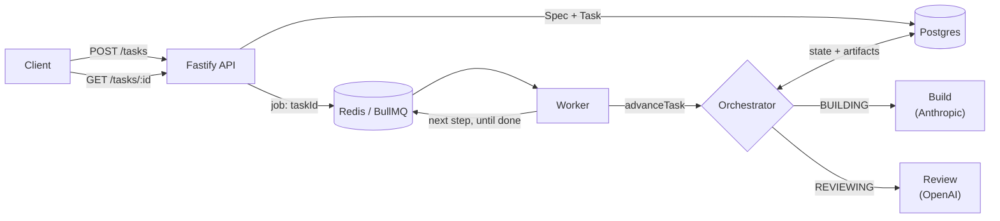

# AI Dev Office

A multi-agent LLM system that runs like a software-development office: each
**department** (Research → Product → Architecture → Build → Review → Delivery)
is an LLM agent, and each can run on a **different provider** — Anthropic,
OpenAI, Google or Mistral.

The focus is **efficiency**: every LLM call records provider, model, tokens,
cost and duration, so the cost and time of each task is visible and capped.

> **Status:** Phase 1 complete (`v0.2.0`) — HTTP API, Postgres, resumable
> task state machine and a BullMQ background worker. Next: Phase 2 — see
> [Roadmap](#roadmap).

## Highlights

- **Provider-agnostic LLM layer** — `callLlm(department, prompt)` wraps four
  SDKs behind one interface and returns text, token counts, USD cost and
  latency. Every call is stored in Postgres.
- **Cross-provider review** — Review always runs on a different provider than
  Build, so the reviewer doesn't share the author's blind spots.
- **Budget-capped feedback loop** — Build ↔ Review repeats on FAIL, but stops
  at a per-task budget ($1, checked before every LLM call) or after 3 loops.
- **Documents, not conversations** — departments hand off typed artifacts
  (Spec, Code, Review) that reference each other **by ID**. The orchestrator
  resolves IDs and gives each agent only the context it needs, keeping prompts
  small and cheap.
- **Resumable state machine** — each task's state lives in Postgres and
  `advanceTask(taskId)` runs exactly one step, so a crash loses at most one
  LLM call and the task carries on from where it stopped.
- **Background workers** — steps run as BullMQ jobs with retries and
  concurrency limits; the API replies instantly and never waits on an LLM.
- **Pure agents** — agents are side-effect-free prompt builders/parsers; all
  I/O and coordination live in one orchestrator.

## How it works



1. A client posts a **Spec** (title, description, acceptance criteria). The API
   saves it with a new **Task** and queues one job — just the task ID.
2. A **worker** takes the job and calls `advanceTask`, which reads the task's
   status from Postgres and runs one step: **Build** writes code, or
   **Review** replies PASS/FAIL against the acceptance criteria.
3. The new status is saved and, if the task isn't finished, the next job is
   queued. On FAIL, Build gets the review feedback and tries again — until
   PASS, the budget cap, or the loop limit.
4. The client polls `GET /tasks/:id` for live status and cost, and
   `GET /tasks/:id/code` for the result.

**Measured:** the sample FizzBuzz spec passes review on the first loop for
about **$0.0035** per task (Build on Anthropic, Review on OpenAI).

More detail: [docs/HOW-IT-WORKS.md](docs/HOW-IT-WORKS.md) ·
[docs/DECISIONS.md](docs/DECISIONS.md)

## API

| Route | Does |
|---|---|
| `POST /tasks` | Body `{ title, description, acceptanceCriteria[] }`. Creates the task and replies `201` immediately. |
| `GET /tasks/:id` | Status (`BUILDING` / `REVIEWING` / `PASSED` / `FAILED_*`), loop count, cost so far. |
| `GET /tasks/:id/code` | The latest code from Build. |

## Project structure

```
src/
  server.ts         Fastify app (pnpm api)
  routes/tasks.ts   POST /tasks, GET /tasks/:id, GET /tasks/:id/code
  worker.ts         BullMQ worker (pnpm worker): one task step per job
  queue.ts          Redis connection + task queue
  orchestrator.ts   state machine: advanceTask() runs one Build or Review step
  store.ts          Postgres access via Prisma, mapped to the artifact types
  llm.ts            callLlm(): one interface over Anthropic/OpenAI/Google/Mistral
  config.ts         department → provider/model map, prices, budget & loop caps
  agents/dev.ts     Build prompt builder
  agents/qa.ts      Review prompt builder + PASS/FAIL parser
  main.ts           demo client: submits a sample spec and polls it
docs/
  office-contracts.ts   Spec / Code / Review / Task types
prisma/
  schema.prisma         tables: Spec, Code, Review, Task, LlmCall
docker-compose.yml      Postgres + Redis
```

## Getting started

Requires Node.js 22+, pnpm and Docker.

```bash
pnpm install
cp .env.example .env     # add your API keys
docker compose up -d     # Postgres + Redis
pnpm db:migrate          # create the tables

pnpm worker              # terminal 1 — runs the LLM steps
pnpm api                 # terminal 2 — http://localhost:3000
pnpm start               # terminal 3 — submit a sample task and watch it run
```

Only the Build and Review providers are called so far (Anthropic and OpenAI by
default); the department → model mapping is in `src/config.ts`.

## Roadmap

- [x] **Phase 0** — plain TypeScript: Spec → Build → Review loop with budget cap and cost reporting
- [x] **Phase 1** — Fastify + Prisma + Postgres, orchestrator as a state machine, BullMQ jobs
- [ ] **Phase 2** — real GitHub repos (branches, PRs), tests in Docker, GitHub Actions deploy to staging
- [ ] **Phase 3** — Angular UI: office floor, task board, human approval gates, cost dashboard, model picker per department
- [ ] **Phase 4** — Research + Architecture departments, smart model routing per task

## Tech stack

TypeScript (ESM) · Node.js · Fastify · Prisma · Postgres · BullMQ · Redis ·
Docker Compose · Anthropic, OpenAI, Google Gemini & Mistral SDKs

## License

[MIT](LICENSE)
